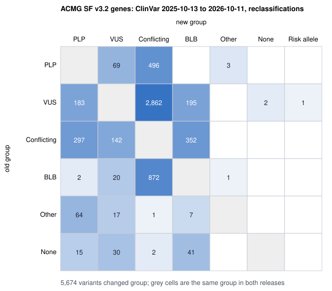

# clinvar-delta

A Nextflow pipeline that does two things with ClinVar:

1. Panel report: takes a germline VCF, normalises it, adds ClinVar classifications,
   review stars and gnomAD allele frequencies, and lists the variants in a gene panel
   (here the 81 ACMG SF v3.2 genes) that ClinVar calls pathogenic or likely pathogenic.
2. Release audit: compares two ClinVar releases variant by variant and reports what
   changed: reclassifications (for example VUS to likely pathogenic), changes in review
   level, new and withdrawn records, and changes to location, allele or gene alone.

## Reclassification audit

ClinVar is updated every week. A variant reported as "uncertain" to a patient last year
may now be "likely pathogenic", and the reverse also happens. Between the 2025-10-13 and
2026-10-11 releases, 40,961 variants moved to a different classification group, 19,907 of
them from VUS to conflicting; in the 81 ACMG genes, 183 went from VUS to P/LP and 69 went
from P/LP to VUS. ([clinvar-history](https://github.com/Daneshpajouh/clinvar-history)
counts 20,364 VUS to conflicting from the monthly `variant_summary` files of 2025-10 and
2026-10; the files and dates differ.) The diff lists the variants whose reports may need
review and keeps classification changes apart from changes in other fields.
[docs/explainer.md](docs/explainer.md) covers the background.



Drawn by `scripts/plot_transitions.py` from the committed
[release-diff report](docs/examples/clinvar_diff_report.md).

## Quick start

Needs Nextflow 26.04.0 or newer and Java 17 or newer. Without containers, also these tools
on PATH: bcftools and tabix (checked with 1.16 on Debian 12 and 1.23 on macOS), Python
3.11 or newer, and on Linux `procps`, because Nextflow runs `ps` in every task to record
metrics and the task fails without it.

```bash
git clone https://github.com/Daneshpajouh/clinvar-delta.git
cd clinvar-delta

# Annotate two bundled samples: real HG002 records in BRCA1, BRCA2 and TP53, and one synthetic sample
nextflow run . -profile test --outdir results
# ...
# [SUCCESS] completed=19 failed=0 cached=0

# Compare the bundled cuts of two ClinVar releases
nextflow run . -profile test_diff --outdir results_diff

ls results/report results_diff/clinvar_diff
```

Each run took about 4 s on a clean Debian 12 container and on an Apple M-series Mac,
after Nextflow downloads the nf-schema plugin on first use. `bin/cvnf` runs the Python
tools from the checkout.

With Docker instead of local tools, add the profile: `-profile test,docker`. The tools
image `ghcr.io/daneshpajouh/clinvar-delta:1.0.2` is pulled on first use (`make image`
builds it locally instead). On 2026-10-19 the test profile ran this way from the published
1.0.1 image in 17 s on the Mac (19 tasks), and test_diff in 8 s (7 tasks). The test profiles
read `tests/data` by relative path, so run them from the clone root.

## Real-data results

From the 2026-10-19 runs, panel annotation on v1.0.0 and the release diff on v1.0.1 (commands
and full tables in [docs/results.md](docs/results.md)):

| | |
|---|---|
| HG002 (GIAB v4.2.1) variants in the 81 ACMG SF v3.2 genes | 9,807 |
| of which ClinVar P/LP, any review level | 0 |
| ClinVar 2026-10-11 records compared with 2025-10-13 | 4,594,764 against 3,878,123 |
| reclassified between groups / review level changed / annotation only | 40,961 / 164,786 / 4,427 |
| added / removed | 725,461 / 8,820 |
| wall time, panel annotation of HG002 / full release diff | 30.9 s / 1 min 20 s |

## Documentation

| Page | Content |
|---|---|
| [explainer](docs/explainer.md) | ClinVar, review stars and reclassification in plain language |
| [quick start and usage](docs/usage.md), [parameters](docs/parameters.md) | running on your data, profiles, outputs |
| [results](docs/results.md) | real HG002 and release-diff numbers with the exact commands |
| [profiling](docs/profiling.md) | before, during and after a run: trace report, calibrated requests, Slurm accounting |
| [testing](docs/testing.md), [test report](docs/test_report.md) | the four test layers and the v1.0.1 results |
| [maintenance](docs/sop.md) | monthly ClinVar update, versioning, deprecations |
| [operations notes](docs/operations.md) | failures hit while building this, and their fixes |
| [data sources](docs/data_sources.md) | every downloaded file with URL, size, SHA-256 and terms |

## Layout

```
main.nf                 entry: --mode annotate | diff
workflows/              ANNOTATE and CLINVAR_DIFF
modules/local/          one process per directory, each with a stub block
conf/                   resource labels, Slurm, calibrated requests, test profiles
src/cvnf/               Python tools (diff, report, profiling), typed, no dependencies
bin/cvnf                runs src/cvnf from the checkout when the package is not installed
tests/                  pytest (unit, CLI, pipeline), nf-test, data and mocks
containers/             Dockerfile and Apptainer definition for the tools image
scripts/                data download and test-data builder
```

## Design choices

- Python with no third-party dependencies: the tools image is the slim Python base plus
  `procps`. The cost is a hand-written VCF reader, fine for panel-sized files but slow for
  a whole genome; bcftools normalises and annotates the records.
- bcftools rather than VEP or SnpEff: ClinVar and gnomAD matching needs exact allele
  matches after normalisation, which `bcftools annotate` does. Consequence annotation
  (HGVS, transcript) is not part of 1.0.
- One container per tool, so bcftools can move to a new BioContainers build without
  rebuilding the Python image, at the price of two images to pin.

## Licence and citation

Apache-2.0. See [CITATION.cff](CITATION.cff). This is research software: the reports are
not clinical reports.
